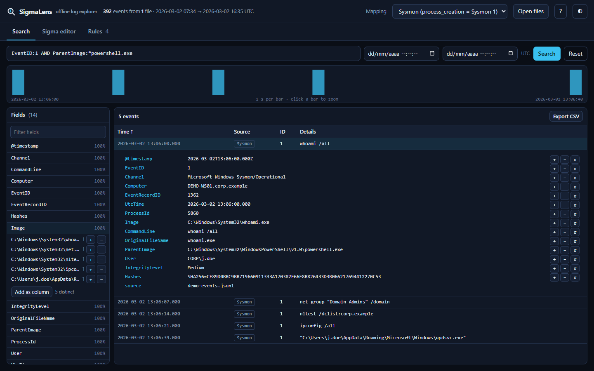
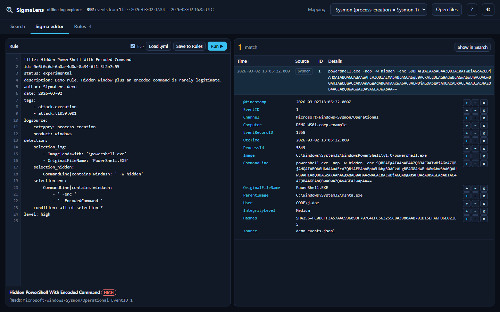

# SigmaLens

**Offline log explorer with a live Sigma rule editor, for Windows, Linux, cloud, identity, email and network logs. One HTML file, no install, no server, nothing uploaded.**

SigmaLens gives you the hunting workflow of a SIEM in a browser tab: a search bar, a timeline, field statistics and a Sigma editor that shows matches as you type. It was built for DFIR and detection engineering training, where students get a folder of logs and need to explore them, write detections and check whether those detections fire.



## Features
- **Search** with a Lucene-like syntax: `EventID:1 AND Image:*\powershell.exe AND NOT User:*SYSTEM`, wildcards, phrases, numeric comparisons, `_exists_:`.
- **Automatic setup**: when you load data, the Host, User and Source IP columns are filled from the right field for each source, and the process_creation mapping (Sysmon 1, Security 4688 or both) is chosen from the events you have.
- **Timeline histogram** (click a bar to zoom, − / + to change the bucket size), **field statistics** with top values, one-click include/exclude filters you can undo from the same column, and extra columns. Every panel can be resized (drag the bars between them; double-click to reset).
- **Sigma editor** with live matching: maps and lists, keyword lists, `condition` with `and/or/not`, parentheses, `1 of x*`, `all of them`, and the modifiers `contains startswith endswith all re i m s cased exists gt gte lt lte cidr windash`.
- **Many log sources, recognised automatically** by the fields each event has: Windows, Linux (syslog, journald, auditd, Sysmon for Linux), AWS CloudTrail, Entra ID sign-ins and audit logs, Azure activity, Microsoft 365 audit, Google Cloud audit, Okta, Proofpoint TAP, Suricata EVE, Zeek, web proxy, web server, firewall and DNS logs. A rule with `product: aws` / `service: cloudtrail`, `product: linux` / `service: sshd`, `category: proxy` and so on only reads those events. Search by source with `_source_:linux`.
- **Email (.eml)**: each message becomes one event with all its headers plus `eml.*` fields (sender, Return-Path and Reply-To domains, SPF/DKIM/DMARC results, Received hops and origin IP, URLs and their domains, attachment names, types and SHA-256).
- **Logsource mapping** for Windows: Sysmon event IDs per category, PowerShell 4104 for `ps_script`, services such as `security`. `process_creation` can read Sysmon 1, Security 4688 (with `Image`, `ParentImage` and `User` mapped from 4688 fields) or both.
- **Rules view**: load a folder of rules and run them all to see which ones fire.
- **Export** search results to CSV.
- **Built-in guide** (Guide tab) with runnable examples.
- Works from `file://` with no network access, in light and dark mode.



## Quick start
1. Download `dist/sigmalens.html` and open it in Chrome, Edge or Firefox.
2. Drop your logs (`.json`, `.jsonl`), emails (`.eml`) and Sigma rules (`.yml`) onto the page.

**Try it online:** https://sigmalens.n4zar1.com (the demo build; your files still never leave the browser). Offline, open `dist/sigmalens-demo.html` and click **Load demo dataset**. It's a synthetic workstation day with a made-up intrusion and four example rules.

### Getting logs into JSONL
SigmaLens reads JSON objects, one per line. It also reads JSON arrays, a single (pretty-printed) JSON object, CloudTrail/Azure `{"Records":[…]}` files, Proofpoint TAP SIEM API responses and the nested `evtx_dump` / python-evtx format (`{"Event":{"System":…,"EventData":…}}`). Nested objects become dotted field names (`userIdentity.arn`). On Linux, `journalctl -o json` output loads as is.

On Windows, convert `.evtx` files with the included script. It only uses built-in cmdlets:

```powershell
.\tools\evtx2jsonl.ps1 -Path .\Logs\*.evtx -OutDir .\jsonl
```

## Limits
- Aggregations (`| count() by …`), correlation rules and the `base64`/`base64offset`/`utf16` modifiers are not supported. The editor reports them as errors.
- Everything runs in memory. A few hundred thousand events are fine on a normal laptop.
- Matching follows the Sigma specification: values are case-insensitive unless `|cased`, `*` and `?` are wildcards, and `\*` is a literal asterisk.

## Development
```bash
node --test tests/                    # engine tests (Node 18+)
python tools/make_demo.py             # regenerate the demo dataset
python tools/build.py                 # dist/sigmalens.html
python tools/build.py --demo          # dist/sigmalens-demo.html (demo data embedded)
```
`src/engine.js` holds the parser and matching logic and has no DOM dependencies. `src/app.js` is the UI. The build inlines everything into a single HTML file.

## License
MIT © Carlos Fernández ([N4zar1](https://n4zar1.com)). Sigma is an open standard maintained by [SigmaHQ](https://github.com/SigmaHQ/sigma); SigmaLens is an independent project.
